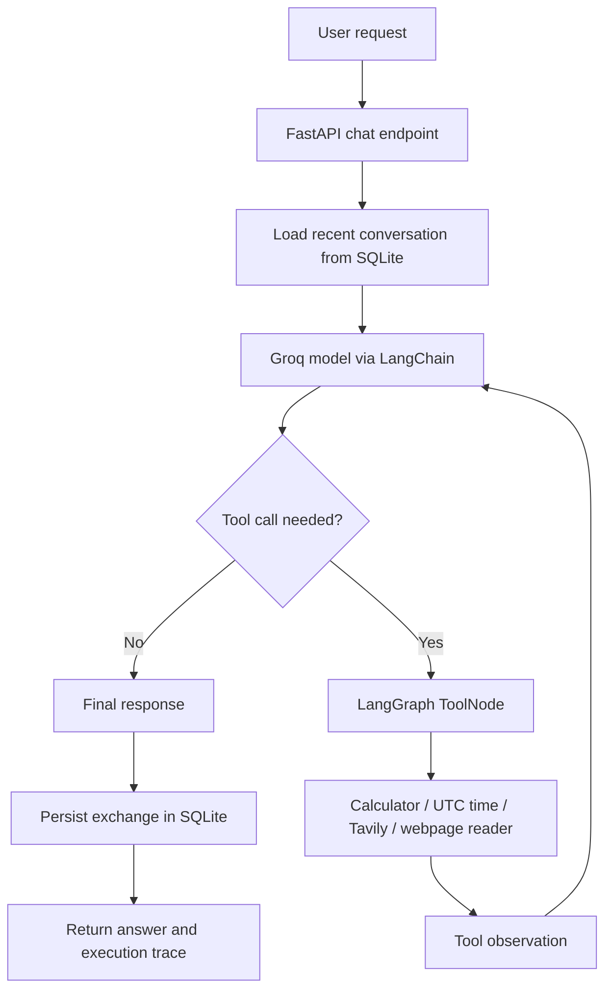

# Atlas — Autonomous AI Research Agent

> A tool-using AI agent that decides when to call tools, observes their results, and synthesizes a response. Built with LangGraph, Groq, FastAPI, and SQLite conversation memory.


## Overview

Atlas is an agentic AI application rather than a single prompt-response endpoint. The model can decide whether a task needs a tool, request that tool through structured tool calling, inspect the returned observation, and continue until it produces a final answer or reaches the configured graph recursion limit.

### Features

- LangGraph state graph for model/tool orchestration.
- Groq chat model through an OpenAI-compatible API.
- Safe calculator using a restricted Python AST evaluator.
- Current UTC time tool.
- Optional live web search through Tavily.
- Public webpage text extraction.
- SQLite-backed conversation history.
- Configurable agent step budget and request timeout.
- FastAPI REST API, Swagger docs, and responsive browser UI.
- Unit tests for tool safety and conversation persistence.

## Workflow



## Agent cycle

1. Receive a user message and conversation ID.
2. Load recent messages from SQLite.
3. Invoke the model with system instructions, history, and tool schemas.
4. Route model-requested tools through LangGraph.
5. Return tool observations to the model.
6. Repeat until the model produces a final answer or the recursion limit is reached.
7. Persist the user/assistant exchange and return the answer plus a lightweight trace.

## Architecture

| Layer | Technology | Responsibility |
|---|---|---|
| API | FastAPI | Chat, history, delete, health |
| Orchestration | LangGraph | State graph and tool routing |
| Model interface | LangChain OpenAI integration | Tool-enabled chat model |
| Model provider | Groq | LLM inference |
| Tools | LangChain tools | Calculator, time, web search, webpage reader |
| Search | Tavily (optional) | Current web search |
| Web extraction | HTTPX + BeautifulSoup | Extract public page text |
| Memory | SQLite | Persist conversations |
| UI | HTML/CSS/JavaScript | Agent workspace |
| Tests | Pytest | Calculator and memory tests |

## Repository structure

```text
.
├── app/
│   ├── agent/graph.py       # LangGraph agent cycle
│   ├── agent/tools.py       # Tools and restricted calculator
│   ├── api/routes.py        # Chat and conversation endpoints
│   ├── core/config.py       # Environment configuration
│   ├── memory/store.py      # SQLite conversation storage
│   ├── schemas/chat.py      # Pydantic API schemas
│   └── main.py              # FastAPI application
├── data/                    # Runtime database (Git-ignored)
├── scripts/smoke_test.py
├── tests/
├── ui/index.html
├── .env.example
├── .gitignore
├── LICENSE
└── requirements.txt
```

## Quick start

### 1. Clone

```bash
git clone https://github.com/<your-username>/autonomous-ai-research-agent.git
cd autonomous-ai-research-agent
```

### 2. Create environment and install

```bash
python -m venv .venv
source .venv/bin/activate
pip install --upgrade pip
pip install -r requirements.txt
```

Windows PowerShell activation: `.venv\Scripts\Activate.ps1`

### 3. Configure keys

```bash
cp .env.example .env
```

Set your Groq key:

```env
GROQ_API_KEY=your_groq_api_key
GROQ_BASE_URL=https://api.groq.com/openai/v1
LLM_MODEL=openai/gpt-oss-20b
```

`TAVILY_API_KEY` is optional. Add it to enable live web search. Calculator, UTC time, and public webpage reading do not require Tavily.

### 4. Run

```bash
uvicorn app.main:app --reload
```

Open:
- UI: http://127.0.0.1:8000
- API docs: http://127.0.0.1:8000/docs
- Health: http://127.0.0.1:8000/health

## Example prompts

- `Calculate (125 * 4) / 5.`
- `What is the current UTC time?`
- `Search for recent developments in small language models and summarize the main themes.` (Tavily key required)
- `Read https://example.com and summarize its main points.`

## API

### `POST /api/chat`

```json
{
  "message": "Calculate (125 * 4) / 5",
  "conversation_id": "demo-session-001",
  "user_id": "demo-user"
}
```

Response shape:

```json
{
  "conversation_id": "demo-session-001",
  "answer": "The result is 100.",
  "steps": ["Model requested tools.", "Model produced final response."],
  "tool_calls": 1
}
```

### `GET /api/conversations/{conversation_id}?user_id=demo-user`

Returns persisted messages.

### `DELETE /api/conversations/{conversation_id}?user_id=demo-user`

Deletes messages for the selected conversation.

### `GET /health`

Returns service health.

## Configuration

| Variable | Required | Description |
|---|---|---|
| `GROQ_API_KEY` | Yes | Model provider key |
| `GROQ_BASE_URL` | No | OpenAI-compatible API base URL |
| `LLM_MODEL` | No | Model identifier |
| `TAVILY_API_KEY` | No | Enables live web search |
| `AGENT_MAX_STEPS` | No | Graph recursion budget |
| `AGENT_TEMPERATURE` | No | Sampling temperature |
| `REQUEST_TIMEOUT_SECONDS` | No | Model request timeout |
| `SQLITE_PATH` | No | Local conversation database |

## Tests

```bash
pytest -q
```

Tests cover permitted arithmetic, rejection of unsafe calculator expressions, and SQLite conversation persistence. They are unit tests, not a benchmark of agent quality.

## Security and limitations

This is a portfolio/learning project, not a production-ready multi-tenant service.

- The demo UI uses a fixed `demo-user`; authentication and authorization are not implemented.
- The graph recursion limit bounds cycles but does not replace billing controls, quotas, or rate limiting.
- Live web search requires Tavily.
- Page extraction is best-effort; authenticated pages and many JavaScript-heavy sites are unsupported.
- Web content is untrusted. Prompt-injection resistance is not guaranteed.
- The agent does not send messages, make purchases, publish content, or execute consequential external actions.
- Conversation history is stored locally in SQLite; semantic memory and resumable checkpoints are not implemented.
- Model answers can be incorrect. Verify important claims independently.

## Roadmap

- Human approval gates for selected tools.
- LangGraph checkpointing and resumable workflows.
- Structured task plans and progress tracking.
- Streaming responses and token-level progress.
- Authentication, tenant isolation, and audit logs.
- Redis-backed rate limits and background jobs.
- RAG-based long-term memory.
- Evaluation datasets for tool selection, task completion, and factuality.
- LangSmith/OpenTelemetry tracing.

## License

MIT. See [LICENSE](LICENSE).

---

Built to explore agentic workflows, tool calling, state graphs, conversation memory, and practical LLM application engineering.
# Autonomous-AI-research-agent
